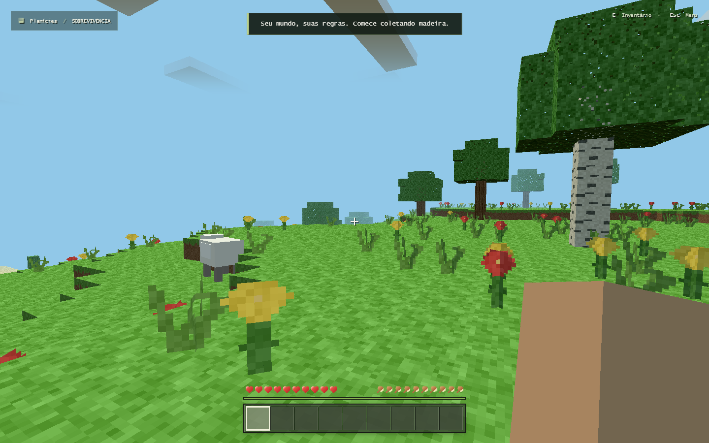

# Minecraft com IA: Claude vs Codex

Dois jogos de blocos em 3D para navegador, um criado pelo Claude e outro pelo Codex, a partir do mesmo desafio.



## Jogar agora

- [Versão Claude](https://paulogalletti.com.br/jogos/minecraft/claude/)
- [Versão Codex](https://paulogalletti.com.br/jogos/minecraft/codex/)
- [Sobre o experimento](https://paulogalletti.com.br/experimentos/minecraft-com-ia/)

## Rodar localmente

Requer [Node.js](https://nodejs.org/) 18 ou superior.

```bash
cd claude   # ou: cd codex
npm install
npm run dev
```

## Conteúdo

| Pasta | Projeto |
| --- | --- |
| [`claude/`](claude/) | Versão do Claude |
| [`codex/`](codex/) | Versão do Codex |

Feito com TypeScript, Three.js e Vite. Texturas, modelos e sons são gerados em código.

## Acompanhe

Mais experimentos no [canal do YouTube](https://www.youtube.com/@PauloGalletti8) e em [paulogalletti.com.br](https://paulogalletti.com.br/).

## Licença e aviso

Código sob licença [MIT](LICENSE). Projeto independente de fãs, sem afiliação com a Mojang ou a Microsoft. Minecraft é marca de seus respectivos titulares.
